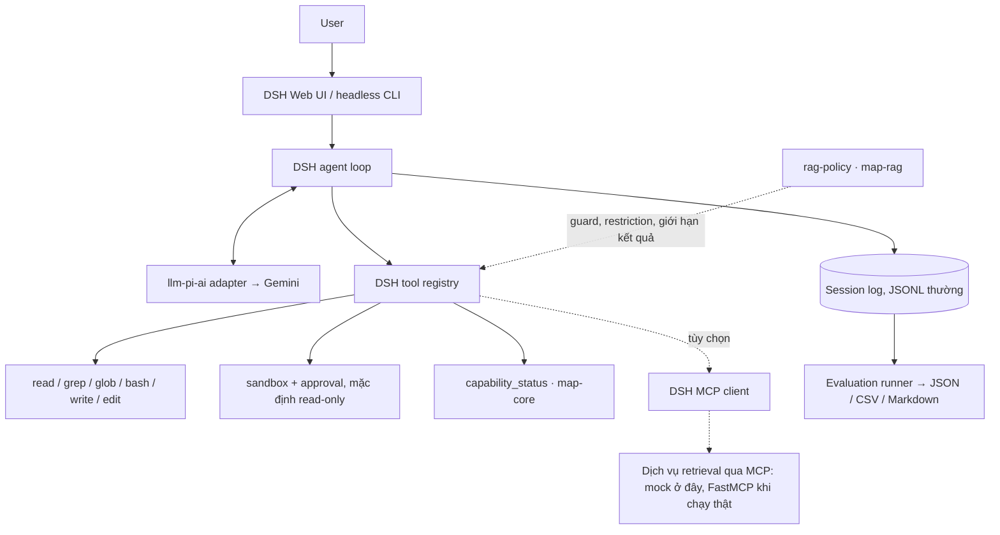

# Kiến trúc (V1)

Bản phân phối này thêm cấu hình, hai plugin nhỏ, một mock retrieval service và một evaluation runner quanh checkout DeepSeek Harness (DSH) không bị sửa. Agent loop, tool registry, model adapter, session log, sandbox, approval và Web UI đều là của upstream.

## Phần nào của upstream, phần nào của dự án

| Thành phần | Chủ sở hữu | Vị trí |
|---|---|---|
| Agent loop, luồng turn và step | upstream | `packages/core/agent-loop` |
| Tool registry, pipeline pre/post-execute, guard | upstream | `packages/core/tools` |
| Route Gemini | adapter của upstream, config của dự án | `packages/llm/llm-pi-ai`, `bundles/core/cordis.patch.yml` |
| Sandbox mode và approval | upstream, mặc định do dự án chọn | `packages/sandbox`, `bundles/core/cordis.patch.yml` |
| Session log | upstream, kiểu mã hóa do dự án chọn | `packages/session`, `bundles/core/cordis.patch.yml` |
| Kết nối MCP | plugin của upstream, config của dự án | `packages/mcp/mcp-client`, `bundles/rag/cordis.patch.yml` |
| Tool `capability_status` | dự án | `bundles/core/src` |
| Chính sách retrieval (deny, hide, bound, label) | dự án | `bundles/rag/src` |
| Agent preset cho Web | dự án (ghép từ plugin upstream) | `bundles/web/cordis.patch.yml` |
| Mock retrieval service | dự án | `mock-rag/` |
| Evaluation: cases, runner, chấm điểm, báo cáo | dự án | `evaluation/` |
| Test mức process | dự án | `tests/` |

## Composition

Một `dsh` đang chạy là một cây plugin dựng từ các layer có thứ tự: các bundle liệt kê trong profile, patch riêng của profile, home patch, rồi các overlay `--patch`. Một patch gọi tên một row theo `id` và thay nguyên `config` của nó, hoặc chèn row mới. Ba bundle ở đây chính là các layer như vậy.

| Profile | Bundle, theo thứ tự | Công dụng |
|---|---|---|
| `map-core-headless` | `dsh-base`, `dsh-headless`, `map-core` | một task từ CLI, không retrieval |
| `map-rag-headless` | `dsh-base`, `dsh-headless`, `map-core`, `map-rag` | như trên, có retrieval tùy chọn |
| `map-core` | `dsh-base`, `dsh-web-app`, `map-core`, `map-web` | Web UI, không retrieval |
| `map-rag` | `dsh-base`, `dsh-web-app`, `map-core`, `map-rag`, `map-web` | Web UI, có retrieval tùy chọn |

`map-core` thay đổi các row upstream sau: model mặc định (`google` / `gemini-3.1-flash-lite`), permission preset mặc định (`read-only`), upload session log (tắt), kiểu mã hóa session log (JSONL thường trong `$DSH_HOME/sessions-plain`), `tool-web` (tắt), các tool delegation, workflow và goal (tắt). Nó chèn thêm `capability_status`.

`map-rag` chèn một row MCP client cho server tên `rag` cùng plugin policy, và báo cho `capability_status` biết cần kỳ vọng server đó.

`map-web` tồn tại vì Web app ghép tool của từng session từ một agent preset chứ không từ các row của host. Nó tắt bốn preset có sẵn và chèn một preset, `map`, với cùng bộ tool như các profile headless.

## Hai plugin

**`capability_status`** (`bundles/core/src/capability-status.ts`) là tool read-only. Nó liệt kê các tool mà agent đang gọi nhìn thấy ở step hiện tại, và với mỗi MCP server được kỳ vọng hoặc đang có mặt, cho biết server đó có đóng góp tool nào không. Server được kỳ vọng mà không có tool được báo là `unavailable`, kèm chỉ dẫn không được nói rằng đã retrieve từ nó.

**`rag-policy`** (`bundles/rag/src/rag-policy.ts`) làm ba việc:

1. **Deny.** `ctx.tools.guard()` từ chối `mcp__rag__sync_documents` với mã `MAP_OPERATOR_ONLY_TOOL`. Guard chạy sau mọi listener `tools/pre-execute` và không có kết quả "allow", nên không plugin nào khác biến lệnh từ chối thành cho phép được. Lệnh gọi không bao giờ tới dịch vụ.
2. **Hide.** `agent.ctx.tools.restrict({ deny })` gỡ tool khỏi danh sách tool của agent. Restriction chỉ gọi tên được tool đã đăng ký, mà dịch vụ có thể kết nối sau khi agent đã tồn tại, nên plugin kiểm tra ở `agent/created` và lại kiểm tra trước mỗi step. Ẩn tool là tiện ích cho model; guard mới là cơ chế enforce.
3. **Bound và label.** Một listener `tools/post-execute` thay nội dung của kết quả `retrieve_context` thành công. `renderRetrievedContext` (`bundles/rag/src/evidence.ts`) parse JSON của dịch vụ, giữ tối đa `maxEvidence` đoạn, `maxEvidenceChars` ký tự mỗi đoạn và `maxTotalChars` tổng cộng, báo lại những gì đã cắt, rồi bọc các đoạn trong một phần tử `<retrieved_context trust="untrusted">` nói rõ chúng là dữ liệu chứ không phải chỉ dẫn. Chỉ hiển thị metadata nguồn do dịch vụ cung cấp; đoạn không có nguồn được ghi `source=unknown`.

MCP client ở commit pin không có allowlist theo từng tool, vì vậy chính sách này là plugin chứ không phải cấu hình.

## Hành vi khi retrieval lỗi

| Tình huống | Điều xảy ra | Test |
|---|---|---|
| Dịch vụ tắt lúc khởi động | Harness vẫn khởi động; không có tool `mcp__rag__*` nào được đăng ký; `capability_status` báo `unavailable` | T07 |
| Lệnh gọi vượt `toolCallTimeoutMs` | Một tool result lỗi; turn kết thúc bình thường; harness không retry | T08 |
| Dịch vụ trả lỗi | Tool result lỗi kèm thông điệp của dịch vụ | T08 |
| Evidence rỗng | Kết quả nói rõ không có evidence và không nêu nguồn nào | T09 |
| Đoạn văn độc hại | Được chuyển bên trong phần tử untrusted; tự nó không kích hoạt gì | T10 |
| Kết quả quá lớn | Bị cắt theo giới hạn, kèm cảnh báo | T10 |
| Mất dịch vụ giữa session | Upstream reconnect tối đa `maxAttempts` lần (ở đây là 3), rồi gỡ tool | chưa test ở đây |

## Session và trace

Mỗi session là một file JSONL append-only dưới `$DSH_HOME/sessions-plain/<workspace>/<session-id>/`. Dòng đầu là header; mỗi dòng sau có dạng `{ type, seq, time, data }`. Evaluation đọc `turn/*`, `step/*`, `tool/call`, `tool/result`, `assistant/message` (kèm `usage`) và `permission/preset` (`evaluation/runner/trace.ts`). Resume một session sẽ thêm một turn; các tool call trước đó là lịch sử và không được thực thi lại (T13).

Upstream mặc định ghi log nén và từ chối trộn hai kiểu mã hóa trong cùng một root, nên log thường dùng root riêng, nằm cạnh `sessions/` nếu có.
